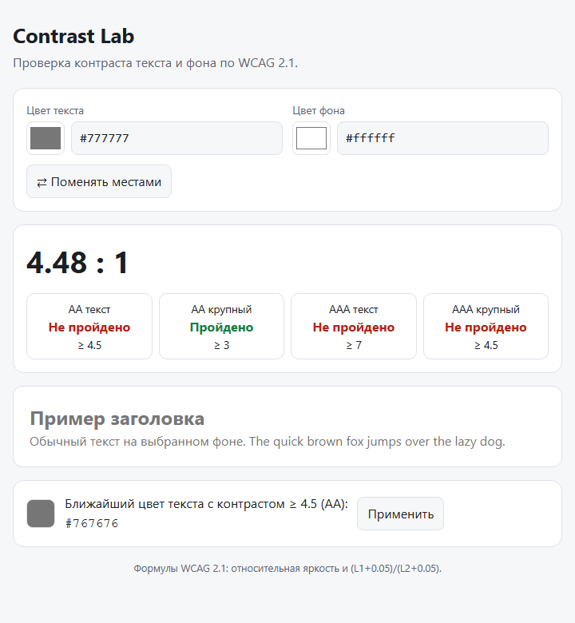

# Contrast Lab

[](https://github.com/Oleg4311/contrast-lab/actions/workflows/ci.yml)

Проверка контраста текста и фона по WCAG 2.1: коэффициент, уровни AA и AAA для обычного и крупного текста, живой предпросмотр и подбор **ближайшего** цвета текста, который проходит AA (4,5:1) и сохраняет оттенок исходного. Цвета хранятся в ссылке (`#текст-фон`), поэтому результатом удобно делиться.

**Открыть:** https://oleg4311.github.io/contrast-lab/ · [English](#english)



## Быстрый старт

Откройте страницу, введите цвета текста и фона (или выберите палитрой). Если контраст не проходит AA, ниже появится подобранный цвет и кнопка «Применить».

## Чем отличается

- **Подбор, а не только оценка.** Многие проверки контраста говорят «не проходит». Здесь предлагается ближайший по цвету вариант, который проходит, и его можно применить одним нажатием.
- **Один файл без зависимостей и сборки.** `index.html` можно открыть локально, форкнуть или встроить.
- **Расчёт сверен с эталонами WCAG.** Чёрный на белом даёт 21:1, `#767676` на белом проходит AA (4,54), а `#777777` уже нет (4,48). Подбор проверяется на 400 случайных парах цветов: предложенный цвет всегда проходит AA.
- **Доступность проверена автоматически** (axe) в светлой и тёмной теме на десктопе и телефоне.

## Как это работает

Относительная яркость по формуле WCAG 2.1 (с линеаризацией sRGB), контраст = (L₁ + 0,05) / (L₂ + 0,05). Подбор смешивает цвет текста с чёрным или белым шагами по 1% и берёт ближайший к исходному из подходящих.

## Разработка

```
npm install
npm run e2e      # сценарии в браузере (Playwright; один раз: npx playwright install chromium)
npm run build    # site/ со страницей и version.json
```

В CI после каждого деплоя те же сценарии повторяются на опубликованном адресе, а коммит на сайте сверяется с `main` инструментом [release-receipt](https://github.com/Oleg4311/release-receipt).

## English

**Contrast Lab** checks text/background contrast against WCAG 2.1 (ratio, AA/AAA for normal and large text, live preview) and, when the pair fails AA, suggests the **closest** text colour that passes while keeping its hue. Colours live in the URL fragment (`#fg-bg`) so results are shareable. It is a single dependency-free HTML file; the maths is checked against reference WCAG values and the suggestion is verified on 400 random colour pairs.

---

Лицензия MIT · Сделано с помощью Claude
